<div align="center">

# Mirli

**Free, open-source, local alternative to ElevenLabs and Suno.**

An AI sound effects generator, AI music and song generator, text-to-speech and
voice cloning app that runs open-weight models on your own GPU. Arrange it all
on a multi-track timeline, stream speech into a game or a chat agent, or let
Claude Code, Cursor or any MCP agent drive it. No account, no credits, works
offline. MIT licensed.

[Download](#download) · [Features](#features) · [For agents](#for-agents) · [Models](#models) · [Docs](#docs) · [Website](https://mirli.app/) · [Patreon](https://patreon.com/soundboxai)

[](https://github.com/HamSanders/soundbox/releases/latest)
[](https://github.com/HamSanders/soundbox/releases)
[](LICENSE)
[](docs/MCP.md)
[](https://patreon.com/soundboxai)

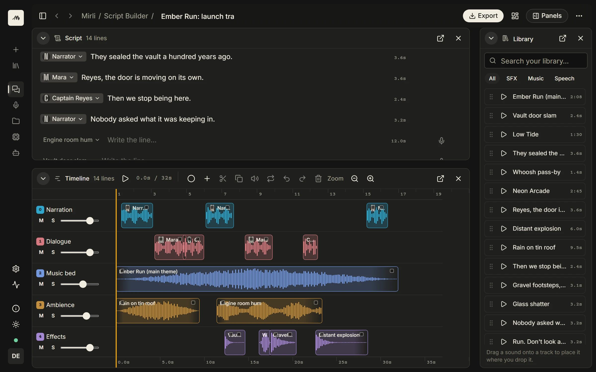

**Watch:** [30-second tour](https://mirli.app/media/soundbox-vibe.mp4) · [Under the hood](https://mirli.app/media/soundbox-tech.mp4) · [Agents and MCP](https://mirli.app/media/soundbox-agents.mp4)

</div>

> Mirli was formerly Soundbox. The repository, the `soundbox` command, the
> `soundbox.*` MCP tools and the installer file names keep the old name for now.
> Environment variables are `MIRLI_*`; the old `SOUNDBOX_*` names still work.

## Features

**Sound effects and ambience.** Type the material, the action and the space,
and get foley, game SFX, UI sounds and seamless ambience loops as WAV files.
[Hear 600 samples](https://mirli.app/sfx/) · [Prompting guide](docs/GENERATING.md)

**Music and songs.** Instrumentals and loops from a style prompt, or full songs
with vocals from a lyric sheet. Extend a track, cover it in another style, or
repaint a section. [Hear tracks](https://mirli.app/music/)

**Text-to-speech and voice cloning.** 45 speech models, from Kokoro to
Chatterbox, IndexTTS 2 and Fish Audio S2 Pro. Clone a voice from up to five
clips, recorded or uploaded, and keep it in Voice Lab to reuse anywhere.
Voice conversion turns one recording into another voice.

**Streaming speech.** `POST /api/speak/stream` sends audio while the line is
still being generated, as server-sent events or raw 16-bit PCM, for game
dialogue and live chat agents. VoxCPM2 gets first audio out in about 0.2
seconds on an RTX 5080. [Streaming docs](docs/STREAMING.md)

**Stem separation.** Split any track into vocals, drums, bass and the rest with
HTDemucs or RoFormer models.

**Multi-track studio.** A timeline with effects racks, MIDI and a piano roll,
mixdown and export. Paste a script, cast saved voices onto its lines, and lay
music, ambience and effects underneath.
[Studio docs](docs/STUDIO.md)

**Agents, MCP and API.** An MCP server with 27 tools for Claude Code, Cursor
and other clients, three agent skills including a full game sound pass, a local
HTTP API, and OpenAI-compatible `/v1/audio/speech` and
`/v1/audio/transcriptions` routes.

**Yours, on your machine.** 65 models in the catalog, four verified and on by
default, each with its licence shown before download. Everything lives in one
SQLite file and a folder of WAVs under `~/.mirli`. Profiles keep a separate
library per game or client. Bring your own ElevenLabs or fal key through custom
endpoints if you want a hosted model too.

<picture>
  <source media="(prefers-color-scheme: light)" srcset="site/public/product/app-dashboard-light.webp">
  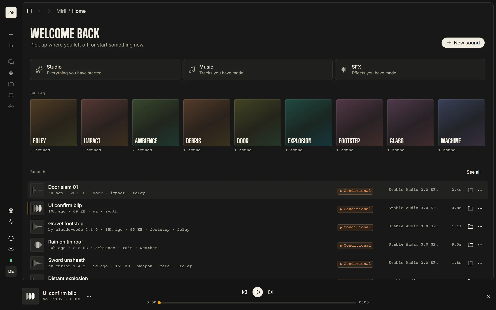
</picture>

<details>
<summary><b>More screenshots</b> · library, music, sound effects, models, details, voices</summary>
<br>

| | |
|---|---|
| 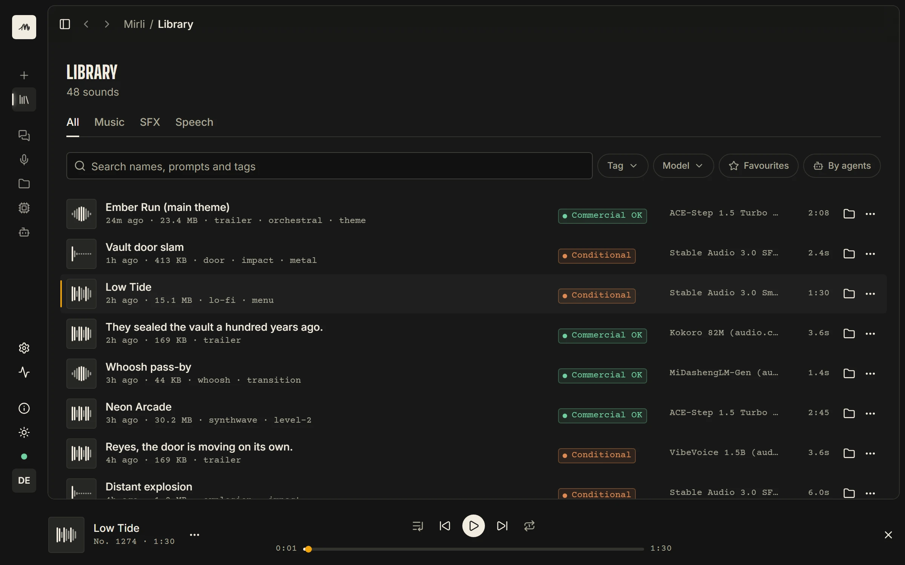 | 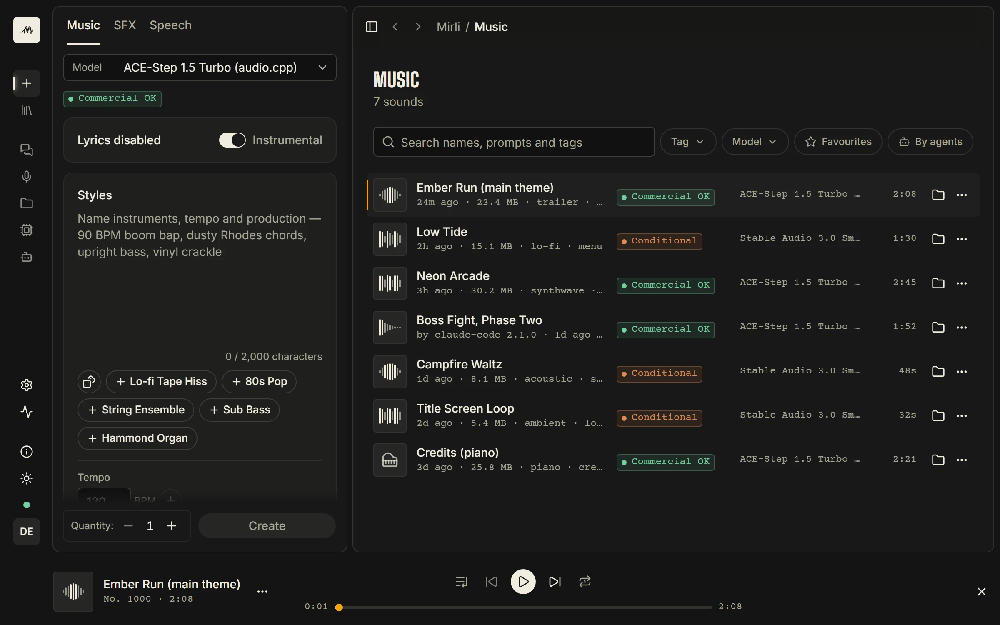 |
| **Library.** Every take in one list, with the player along the bottom. | **Music.** The Create panel beside the tracks it has made. |
| 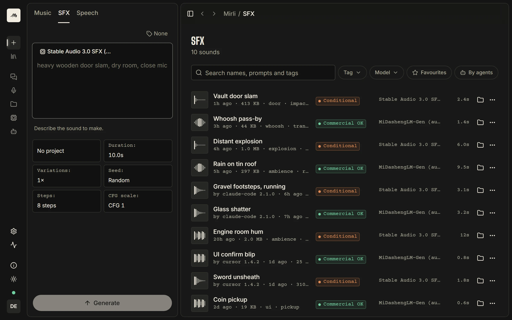 | 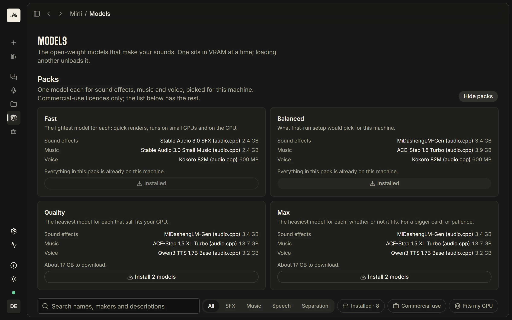 |
| **Sound effects.** Describe it, set a length, generate. | **Models.** Four packs, or pick models one at a time. |
| 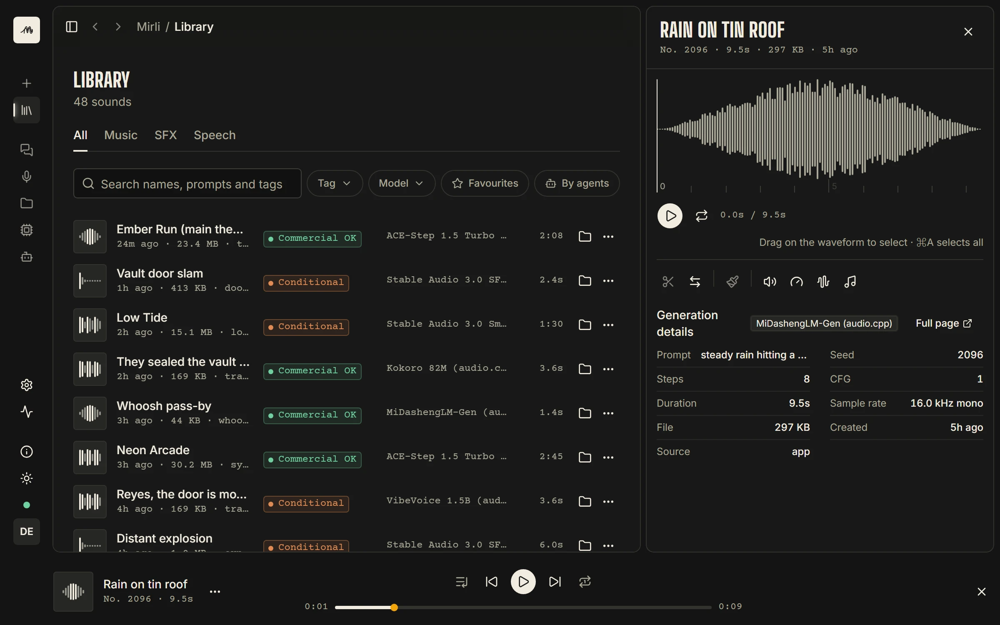 | 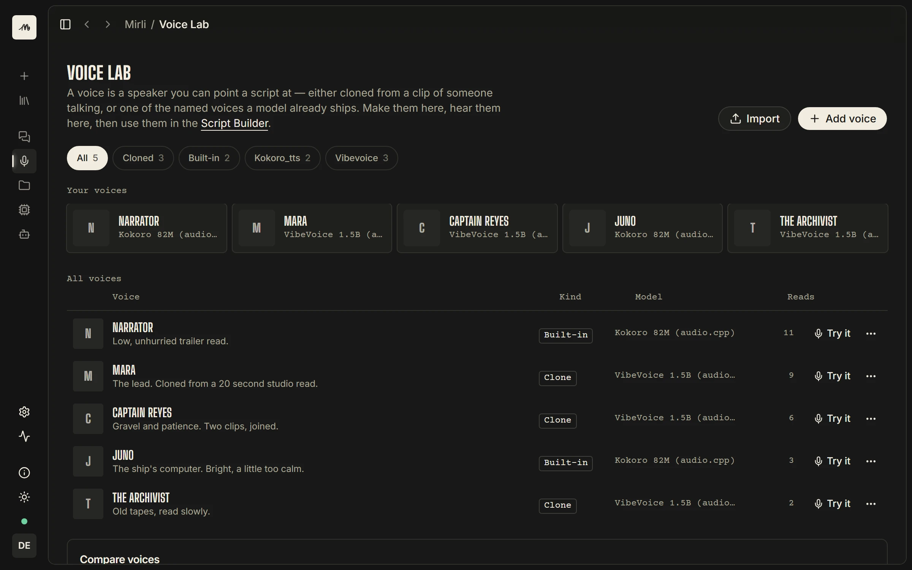 |
| **Details.** Waveform, edits and the exact settings that made it. | **Voice Lab.** Your voices, cloned or built in, and how much each has read. |
| 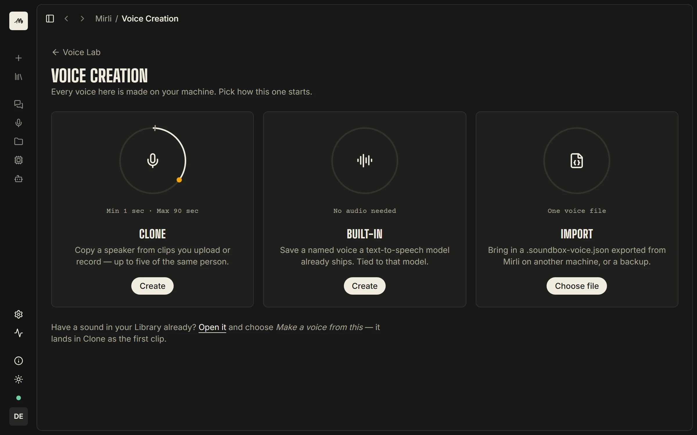 | 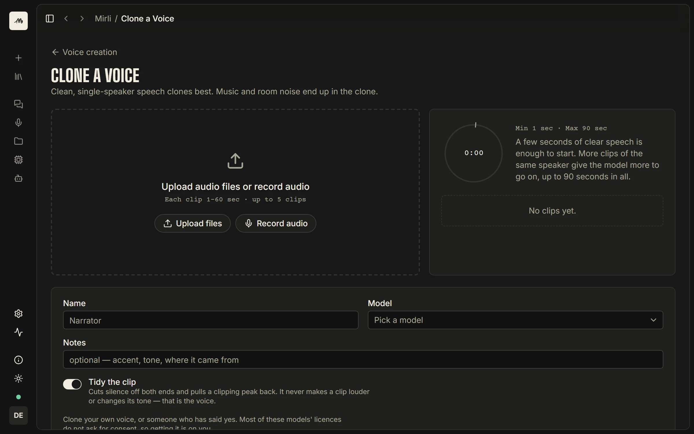 |
| **New voice.** Clone it, pick a built-in, or import one. | **Clone.** Up to five clips of one speaker, recorded or uploaded. |

</details>

## Download

The [download page](https://mirli.app/download/) picks the installer for your system. Or take one directly:

| Platform | Installer |
|---|---|
| **Windows** 10 and 11 (x64) | [`Soundbox_x.y.z_x64-setup.exe`](https://mirli.app/download/) |
| **macOS**, Apple silicon | [`Soundbox_x.y.z_aarch64.dmg`](https://mirli.app/download/) |
| **macOS**, Intel | [`Soundbox_x.y.z_x64.dmg`](https://mirli.app/download/) |
| **Linux** x64 (glibc 2.35+) | [`Soundbox_x.y.z_amd64.AppImage` or `.deb`](https://github.com/HamSanders/soundbox/releases/latest) |

The installer carries its own runtime. The builds are not signed yet, so the
first launch asks you to confirm ([where](docs/DESKTOP.md#installing)). Open
SFX, describe the material, the action and the space, and generate: the first
model downloads when you pick it, with its licence shown first.

| Hardware | What to expect |
|---|---|
| NVIDIA GPU (Windows, Linux) | CUDA. A few GB of VRAM covers the verified models; MiniMax Music 3 wants about 10 GB. |
| AMD or Intel GPU | Runs on the CPU unless you set `MIRLI_AUDIOCPP_BACKEND=vulkan` ([how](docs/AUDIOCPP.md#choosing-a-backend)). Vulkan is not yet confirmed on the verified models; reports welcome. |
| Apple silicon | Metal. Installers exist; none of the verified models has been confirmed on a Mac yet. |
| No dedicated GPU | Works, slowly. A clip that takes seconds on a GPU takes minutes on the CPU. |

Docker and running from source (Linux arm64 included) are under [Run from source](#run-from-source).

### Install with a prompt

Paste this into Claude Code, Cursor or Codex:

```text
Install Mirli on this machine and confirm it works, following
https://github.com/HamSanders/soundbox/blob/main/docs/INSTALL-AGENT.md
```

The guide tells the agent to check the GPU and VRAM first, to show you each
model's size and licence before downloading it, never to accept a
non-commercial licence for you, and to finish by generating one sound and
telling you where the WAV is.

## For agents

Start Mirli, then add it to your client.

```bash
claude mcp add --transport http soundbox http://127.0.0.1:17494/mcp
```

Cursor and other MCP clients take `{ "type": "http", "url": "http://127.0.0.1:17494/mcp" }`.
Then ask: "add a door slam and a coin pickup to this game", "voice these three
lines as two characters", "write a 20-second loading-screen loop". The agent
gets 27 tools for sounds, speech, multi-track stories and the studio you have open, and three skills:
`soundbox-sfx`, `soundbox-sound-pass` and `soundbox-voice-story`. Every tool,
the stdio bridge and the skills are in [docs/MCP.md](docs/MCP.md).

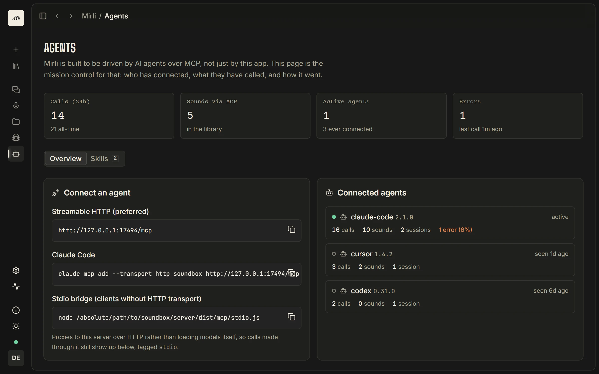

## Models

Every model runs through [audio.cpp](docs/AUDIOCPP.md), a native runtime, so
there is no Python to set up. Verified end to end and on by default:

| Model | Good for | Licence | Commercial use |
|---|---|---|---|
| **Stable Audio 3.0 SFX** | Sound effects, foley, ambience | Stability AI Community | ⚠️ Under $1M revenue |
| **Stable Audio 3.0 Small Music** | Instrumental music, loops | Stability AI Community | ⚠️ Under $1M revenue |
| **ACE-Step 1.5 Turbo** | Songs with lyrics; extend, cover, repaint | MIT | ✅ Yes |
| **MiniMax Music 3** | Songs with lyrics, about 10 GB VRAM | MiniMax-Music3 Community | ⚠️ Conditional |

<details>
<summary><b>61 more in the catalog</b> · 45 text-to-speech, 6 music, 2 SFX, 4 stem separation, 4 voice conversion</summary>
<br>

| Kind | Count | Includes |
|---|---|---|
| Text-to-speech | 45 | Chatterbox, Fish Audio S2 Pro, IndexTTS 2, VibeVoice, Higgs Audio v3, Qwen3-TTS, CosyVoice 3, Kokoro and more; several clone from a reference clip |
| Music | 6 | ACE-Step 1.5 Base and XL, Stable Audio 3.0 Medium, HeartMuLa, MiniMax H3 |
| Sound effects | 2 | MiDashengLM-Gen, ControlFoley |
| Stem separation | 4 | HTDemucs (4- and 6-stem), BS-RoFormer, Mel-Band RoFormer |
| Voice conversion | 4 | RVC, Seed-VC, MioCodec, MeanVC2 |

VibeVoice 1.5B, MiDashengLM-Gen, HTDemucs 6-stem and Chatterbox Turbo have also
been run end to end; the rest are marked unverified until someone reports. The
19 added in October 2026 need audio.cpp 0.9.2 or newer
(`soundbox model install audiocpp` fetches the latest).

</details>

Any model whose licence could not be established is treated as non-commercial.
This is a summary, not legal advice: read each licence before you ship what a
model made.

## Compared with a hosted service

| | Hosted (ElevenLabs, Suno and similar) | Mirli |
|---|---|---|
| Runs on | Their GPUs | Your machine |
| Cost | Subscription or credits | Your electricity |
| Account | Required | None |
| Models | Closed, tuned, consistent | Open weights; quality varies by model |
| Output rights | Their terms of service | The licence of the model that made it, shown up front |
| Offline | No | Yes, once the weights are downloaded |
| Agents | HTTP API | HTTP API and an MCP server |
| Source | Closed | MIT |

## Run from source

<details>
<summary><b>Node, Docker and the HTTP API</b></summary>
<br>

Requires Node 22.12 or later. No Python, no CUDA toolkit.

```bash
git clone https://github.com/HamSanders/soundbox
cd soundbox
npm install
npm run dev
```

This starts the server on port 17494 and the UI on <http://localhost:5174>.
`npm run dev:mock` runs the UI with no GPU or server (see [CONTRIBUTING.md](CONTRIBUTING.md)).

**Docker.** The server and web UI run headless in one container with the
audio.cpp runtime inside. CPU by default; add the CUDA override for a GPU. Both
pull the prebuilt image from GHCR (`:latest`, `:cuda`, or a version such as
`:v0.4.0` and `:v0.4.0-cuda`).

```bash
docker compose up -d
docker compose -f docker-compose.yml -f docker-compose.cuda.yml up -d
```

To build from the checkout instead, add `-f docker-compose.build.yml`
(and `-f docker-compose.build-cuda.yml` for CUDA) and `--build`; see
[docs/INSTALL.md](docs/INSTALL.md#docker).

There is no authentication unless you set `MIRLI_API_TOKEN`, so keep the
port on localhost, or set a token and serve it over HTTPS, and set
`MIRLI_ALLOWED_HOSTS` to the name you reach it by. Details are in
[docs/INSTALL.md](docs/INSTALL.md#access-token).

**HTTP API.** Everything the app does is available on port 17494:

```bash
curl -X POST http://127.0.0.1:17494/api/generate \
  -H 'Content-Type: application/json' \
  -d '{"model":"audiocpp-stable-audio-3-sfx","prompt":"heavy wooden door slamming in a stone corridor","duration_s":3}'
```

Long jobs return an id with a server-sent event stream. Every route is in
[docs/API.md](docs/API.md).

Anything with an OpenAI base URL setting can use Mirli for speech: point it at
`http://127.0.0.1:17494/v1` for `/v1/audio/speech` and
`/v1/audio/transcriptions`. See
[OpenAI-compatible routes](docs/API.md#openai-compatible-routes).

</details>

## Docs

| If you want to | Read |
|---|---|
| Get it running, or fix a first run | [Install](docs/INSTALL.md) · [Desktop](docs/DESKTOP.md) |
| Write prompts these models answer | [Generating](docs/GENERATING.md) |
| Arrange, mix and export | [Studio](docs/STUDIO.md) · [Library](docs/LIBRARY.md) |
| Drive it from an agent or a script | [MCP](docs/MCP.md) · [HTTP API](docs/API.md) |
| Add or verify a model | [audio.cpp](docs/AUDIOCPP.md) · [Contributing](CONTRIBUTING.md) |
| Understand how the pieces fit | [Architecture](docs/ARCHITECTURE.md) |

## FAQ

**Can I sell what I make?** It depends on the model. Stable Audio is free under
$1M revenue, ACE-Step 1.5 is MIT, and models with an unestablished licence are
marked non-commercial. Each model's terms are on its card in the app.

**Do I need a GPU?** No, but CPU generation is slow. The hardware table above
says what to expect.

**Does it work on a Mac?** There are installers for Apple silicon and Intel,
and audio.cpp runs on Metal. None of the verified models has been confirmed on
a Mac yet, so reports are welcome.

**How do I remove it?** Delete the app and `~/.mirli`. There is no account
to close and nothing was uploaded.

## Star history

<a href="https://www.star-history.com/#HamSanders/soundbox&Date">
 <picture>
   <source media="(prefers-color-scheme: dark)" srcset="https://api.star-history.com/svg?repos=HamSanders/soundbox&type=Date&theme=dark" />
   <source media="(prefers-color-scheme: light)" srcset="https://api.star-history.com/svg?repos=HamSanders/soundbox&type=Date" />
   
 </picture>
</a>

## Licence

Mirli is [MIT](LICENSE). The model weights are not: each carries its own
licence, and what you can do with generated audio is governed by the licence of
the model that made it. Clone only voices you have permission to use. Mirli
downloads weights at your direction and does not redistribute them. Example
media under `site/public/` was generated with third-party models; its
provenance is in [ASSETS.md](ASSETS.md).
